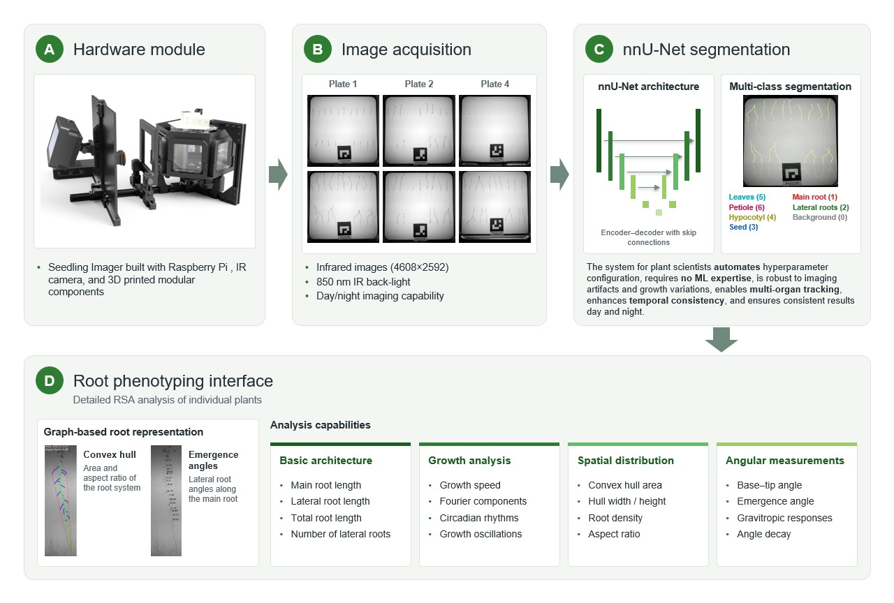
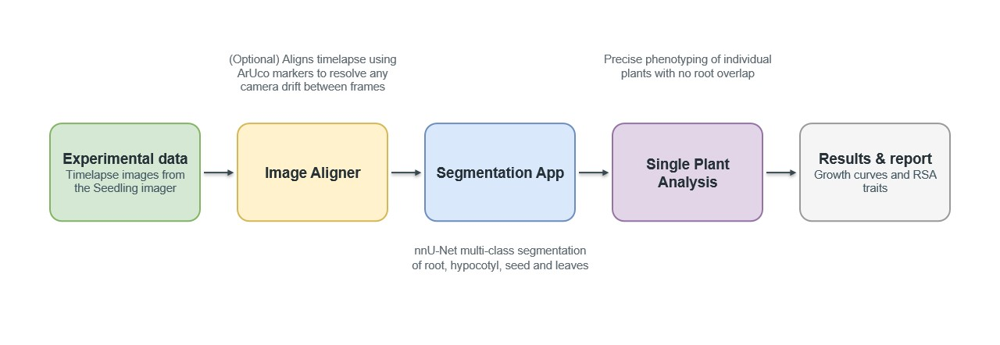

**Website & documentation:** https://calvinyong1.github.io/ArabidopsisAnalysisV2/

# Image Analysis Pipeline

Root phenotyping software for the Seedling Imager. It takes the timelapse images
captured by the imager and turns them into segmented root structures, growth
curves and root system architecture (RSA) traits. It is a fork of
[ngaggion/ChronoRoot2](https://github.com/ngaggion/ChronoRoot2).

This folder (`image-analysis-pipeline/`) is one part of the
[`seedling-imager-controller-display2`](https://github.com/sybednar/seedling-imager-controller-display2)
repository. The repository root contains the Raspberry Pi imager code and
hardware files; everything in this folder is the analysis software.



## Workflow

Timelapse images from the Seedling Imager go through up to three apps, in this order:



## Applications

| App | Folder | Description |
|-----|--------|-------------|
| **ChronoRoot Image Aligner** | `imageAligner/` | (Optional) Aligns a timelapse using ArUco markers to correct camera drift between frames |
| **ChronoRoot Segmentation** | `segmentationApp/` | Segments infrared images into 6 root structure classes using nnU-Net |
| **ChronoRoot Analysis** | `singlePlantAnalysis/` | Detailed RSA analysis of individual plants (graph-based, RSML export) |

---

## Installation (macOS)

> **Requirements:** macOS 12 or later, Intel or Apple Silicon (M-series).
> NVIDIA GPU acceleration is not available on macOS — segmentation runs on CPU.

### Step 1 — Download or clone the repository

```bash
git clone https://github.com/sybednar/seedling-imager-controller-display2.git
cd seedling-imager-controller-display2/image-analysis-pipeline
```

The installer and all the paths below are relative to the `image-analysis-pipeline/`
folder, not the repository root.

### Step 2 — Run the installer

```bash
bash installer_conda_mac.sh
```

The installer will automatically:

1. **Detect your Mac architecture** (Apple Silicon or Intel) and note that NVIDIA GPU is not available on macOS.
2. **Install Miniconda** (if not already installed) — downloads the correct build for your architecture and installs it silently to `~/miniconda3`. You will be prompted to restart your terminal once after this step.
3. **Install Homebrew and libzbar** (if Homebrew is already installed) — `libzbar` is required for QR code detection on older datasets. If Homebrew is missing, the installer will warn you and ask whether to continue without QR support. New datasets using ArUco markers do not require libzbar.
   - To install Homebrew first: visit [https://brew.sh](https://brew.sh)
4. **Create the `ChronoRoot` Conda environment** from `environment.yml`, which includes:
   - Python 3.13, PyQt5, NumPy, OpenCV (contrib), scikit-image, scikit-fda, nnUNetv2, and all other dependencies.
   - If the environment already exists, it updates it in place.
5. **Download segmentation model weights** from Hugging Face into `segmentationApp/models/`.
6. **Create macOS `.app` launchers** in `~/Applications/` with desktop shortcuts on `~/Desktop/`:
   - `ChronoRoot Analysis.app`
   - `ChronoRoot Segmentation.app`
   - `ChronoRoot Image Aligner.app`

### Step 3 — First launch (Gatekeeper)

macOS will block unsigned apps by default. To open each app for the first time:

1. **Right-click** the `.app` on the Desktop (or in `~/Applications/`).
2. Select **Open**.
3. Click **Open** in the confirmation dialog.

You only need to do this once per app.

---

## Running from the Terminal

Activate the environment and launch any app directly (from `image-analysis-pipeline/`):

```bash
conda activate ChronoRoot

# Standard single-plant analysis interface
cd singlePlantAnalysis
python run.py

# Segmentation module
cd segmentationApp
python run.py

# Image aligner
cd imageAligner
python run.py
```

The segmentation module can also run without the GUI: see `segmentationApp/cli.py`
and `segmentationApp/bash_usage.sh`.

---

## Updating Model Weights

If you need to re-download or update the segmentation model weights:

```bash
conda activate ChronoRoot
cd segmentationApp
chmod +x download_weights.sh
./download_weights.sh
```

---

## Other Platforms

| Platform | Installer |
|----------|-----------|
| Linux (Conda) | `bash installer_conda_linux.sh` |
| Windows (WSL2) | `bash installer_conda_wsl.sh` |

Linux and WSL installers support NVIDIA CUDA GPU acceleration for segmentation.
Unlike the macOS installer, they do not use your current checkout: they clone the
repository themselves into `~/.local/chronoroot/seedling-imager-controller-display2/`
(on WSL the install directory can be changed at the prompt) and run the apps from
its `image-analysis-pipeline/` folder. For WSL setup details see
[`WSL_INSTALL.md`](WSL_INSTALL.md).

> **Trouble installing?** A full install guide for every platform is on the
> website: https://calvinyong1.github.io/ArabidopsisAnalysisV2/docs/install/

---

## Directory Structure

```
seedling-imager-controller-display2/        # repository root (Raspberry Pi imager + hardware)
└── image-analysis-pipeline/                # this folder
    ├── imageAligner/              # ArUco-based timelapse alignment app
    ├── segmentationApp/           # nnU-Net segmentation module (GUI + CLI, TRAINING.md)
    ├── singlePlantAnalysis/       # Standard root phenotyping interface
    ├── Documents/                 # Images and documentation assets
    ├── docs/, frontend/           # Documentation website sources
    ├── environment.yml            # Conda environment specification
    ├── environment_no_nnunet.yml  # Conda environment without nnU-Net (analysis only)
    ├── installer_conda_mac.sh     # macOS installer (this guide)
    ├── installer_conda_linux.sh   # Linux installer
    ├── installer_conda_wsl.sh     # Windows WSL2 installer
    ├── WSL_INSTALL.md             # Windows/WSL setup guide
    ├── APP_USAGE_GUIDE.md         # How to use each app
    ├── CHANGES.md                 # Log of analysis pipeline fixes
    └── TODO.md                    # Known unfixed issues
```

---

## Troubleshooting

**`conda` command not found after install**
Close and reopen your terminal, then try again. The installer adds conda to your shell profile, but it takes effect on the next session.

**ArUco marker not detected**
Ensure the printed marker uses the `DICT_4X4_250` dictionary (IDs 0–249). The marker must be at least 100×100 px in the captured image. ArUco detection does not require any additional system libraries.

**QR code detection not working (older datasets)**
Ensure `libzbar` is installed via Homebrew: `brew install zbar`. The `DYLD_LIBRARY_PATH` in the `.app` launcher points to `/opt/homebrew/lib` automatically. QR code support is retained for backward compatibility; new experiments should use ArUco markers.

**Segmentation is slow**
Expected on macOS — nnU-Net runs on CPU. For GPU-accelerated segmentation, use a Linux machine with a CUDA-capable GPU and the Linux installer.

**App won't open / "damaged" warning**
Run `xattr -cr ~/Desktop/"ChronoRoot Analysis.app"` (or the Segmentation or Image Aligner app) in the terminal to clear the quarantine flag, then try opening again.
