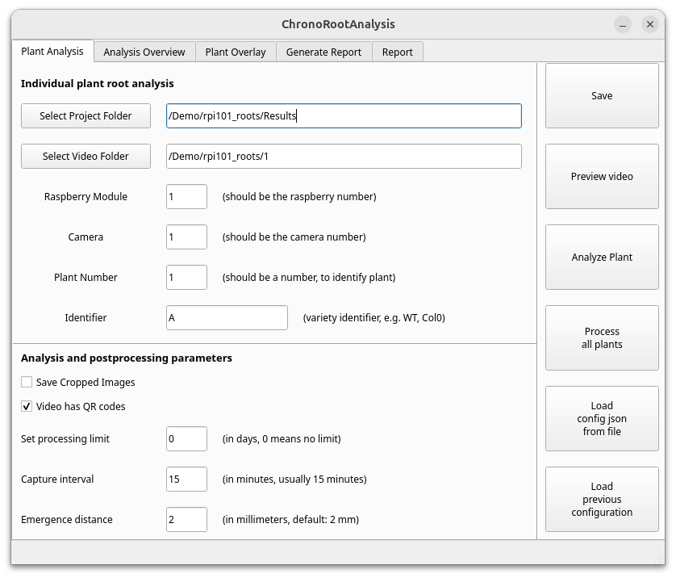

# ChronoRoot 2.0 - Standard Root Phenotyping Interface

This directory contains the Standard Root Phenotyping Interface for ChronoRoot 2.0, designed for detailed architectural analysis of individual plant root systems.



## Overview

The Standard Interface maintains continuity with the original ChronoRoot system while adding modern visualization capabilities and enhanced analysis methods. It provides tools for precise measurement of root system architecture (RSA) parameters and growth patterns through a graph-based representation approach.

## Key Features

- Detailed RSA analysis through graph-based representation
- Temporal tracking of root development
- Real-time visualization of segmentation results
- Comprehensive statistical analysis of growth patterns
- Automated report generation
- Export in Root System Markup Language (RSML) format

## Directory Structure

```
chronoRootApp/
├── analysis/                  # Core analysis modules
│   ├── graphUtils/            # Graph representation utilities
│   ├── imageUtils/            # Image processing utilities
│   ├── rsmlUtils/             # RSML export functionality
│   └── utils/                 # General utility functions
├── placeholder_figures/       # Default images for the interface
├── Screenshots/               # Interface screenshots for documentation
├── 1_analysis.py              # Plant selection and analysis workflow
├── 2_postprocess.py           # Post-processing of analysis results
├── 3_generateReport.py        # Report generation functionality
├── 4_reviewPlant.py           # Quality control and review tools
├── 5_rerun_all_analysis.py    # Batch reprocessing utility
├── calibration_helper.py      # Calibration tool implementation
├── default.json               # Default parameters
└── run.py                      # Main interface implementation
```

## Measurements Provided

The Standard Interface provides the following measurements:

### Basic Architecture
- Main Root (MR) Length
- Lateral Root (LR) Length
- Total Root (TR) Length
- Number of Lateral Roots
- Discrete LR Density
- Main Over Total Root ratio

### Growth Analysis
- Growth Speed
- Fourier Components

### Spatial Distribution
- Convex Hull Area
- Convex Hull Width
- Convex Hull Height
- Root Density
- Aspect Ratio

### Angular Measurements
- Base-Tip Angle
- Emergence Angle

## Usage

### Starting the Interface

```bash
conda activate ChronoRootInterface
python run.py
```

## Scale Calibration

The analysis pipeline converts pixel measurements to millimetres using a physical reference marker placed in the imaging frame, or a manual measurement entered in the GUI.

| Method | UI checkbox | Detection |
|--------|------------|-----------|
| **ArUco** (`DICT_4X4_50`, marker IDs 0-6 only) | *Video has ArUco markers* | `cv2.aruco` |
| **Manual** | *(unchecked)* | Enter known distance (mm) and pixel distance in the GUI |

Only markers from the `DICT_4X4_50` dictionary with IDs 0-6 are detected. Markers generated from the older `DICT_4X4_1000` dictionary are not, so datasets that used them need manual calibration.

The legacy QR-code method (`pyzbar` + `libzbar`) is no longer offered in the GUI. Its detection code is kept, so a hand-edited config with `videoHasQR: true` still works from the command-line scripts.

### Selecting a calibration mode in the GUI

On the **Plant Analysis** tab, the **Video has ArUco markers** checkbox sits just below *Save Cropped Images*. Checking it hides the *Manual Calibration Parameters* panel. Leaving it unchecked shows the panel, where you enter the real-world size of a known feature (*Known (mm)*) and its measured pixel span (*Pixels*), or use the *Open Calibration Helper* tool to measure interactively.

### Checks when you press the analysis button (GUI only)

With the ArUco checkbox ticked, pressing the analysis button first scans the first 20 images:

1. If no marker is found, or the marker is narrower than **300 px**, a warning says to use manual calibration instead and the analysis does not start.
2. Otherwise a precheck window shows the image with the detected marker outlined in green, a zoomed crop and its pixel width. **Looks right - continue** starts the analysis; **Cancel** stops it.

These checks only run from that button. *Process all plants*, re-running an analysis and the command-line scripts do not run them, which is why post-processing prints its own warnings (below).

### Detection order in post-processing (`2_postprocess.py`)

For each of the first 20 image frames, the pipeline tries:

1. **ArUco detection** (if `videoHasAruco` is `true` in the config)
2. **QR detection** (if `videoHasQR` is `true` in the config; legacy)
3. Falls through to the next frame if nothing is found. An unreadable image counts as "no marker" for that frame.

If neither flag is set, the manual `knownDistance` / `pixelDistance` values are used. If a marker was expected but none is found in all 20 frames, it falls back to a built-in default of 0.04 mm/pixel and prints a `WARNING`, because every measurement in mm will then be probably wrong. It also prints a `WARNING` when the ArUco marker is under 300 px wide. The thresholds and defaults live in `analysis/utils/calibration.py`.

The config keys written by the UI are:

| Config key | Source |
|---|---|
| `videoHasArucoButton` / `videoHasAruco` | *Video has ArUco markers* |
| `knownDistance` / `pixelDistance` | *Known (mm)* / *Pixels* (manual calibration) |

Both are saved in `project_config.json` for reproducibility. The QR keys are no longer written, but are still read if present.

### Physical marker size assumption

The ArUco marker side is assumed to be **15 mm** (`ARUCO_MARKER_MM`), measured as the length of the marker's first edge:

```
pixel_size (mm/px) = 15 / aruco_get_pixel_size(corners)
```

Ensure your printed markers match this physical size, or the resulting measurements will be scaled incorrectly. (The legacy QR path assumes 10 mm.)

### Choosing experiments for the report

On the **Generate Report** tab, the **Experiments: n/m** button (top right) opens a checklist of the experiments in `<project>/Analysis/`. Only the checked ones go into the report. The choice is saved as `selectedExperiments` in the config (`null` means all, and a config without the key reports everything). Names that do not exist in the current project are dropped on save, and experiments with no processed plants are skipped.

## Integration with Segmentation

This interface works with segmentation masks produced by the nnUNet module in `segmentationApp/`. For best results, ensure that videos are properly segmented before analysis.